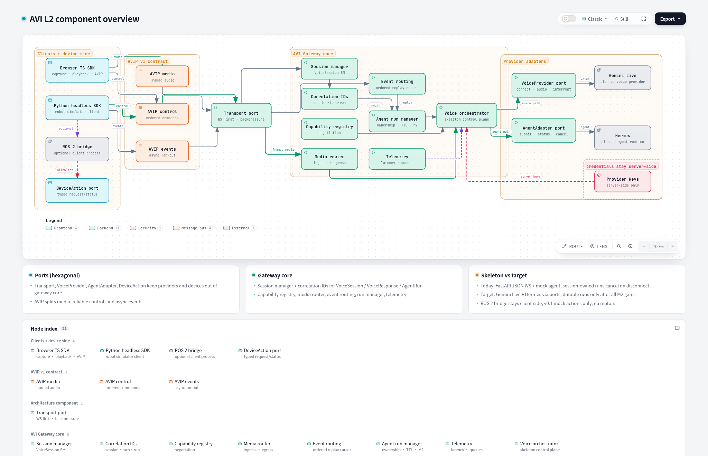

# Agent Voice Interface (AVI)

[](LICENSE)
[](https://github.com/nomi-bot/agent-voice-interface/commits/main)
[](https://github.com/nomi-bot/agent-voice-interface/graphs/commit-activity)


Give every AI agent and robot a natural voice.

AVI is an open-source, plug-and-play voice interaction layer, independent of
agent runtimes and model vendors. It is not an agent framework.

## Current status: initialization skeleton

The current implementation supplies a Python 3.12+ FastAPI gateway, four adapter contracts,
an asynchronous mock agent, a JSON WebSocket control protocol, tests and CI.
The original Apache-2.0 LICENSE is preserved.

**There is no browser audio client, Gemini connection, or working Hermes
integration yet.** No full-duplex, latency or macOS runtime performance claim
has been validated. Provider placeholders fail explicitly rather than simulating
a successful integration. No Google SDK dependency or unverified model ID is
introduced.

M0 is in progress. The gateway validates the AVIP v1 session handshake and serves
it on `/ws/avip`. A ready session lasts only as long as that socket; when the
socket closes, the session id is gone. The development gateway advertises no
audio, camera, display or robot capability. `/ws` still uses the legacy control
protocol below. Binary media framing is a transport-independent contract with a
bounded per-direction queue; `/ws/avip` does not accept those frames yet.
Runnable browser or Python conformance clients are still ahead, so M0 is not complete.

## Local development (macOS / Mac Mini)

Install Python 3.12 or newer (for example, Homebrew: `brew install python@3.12`).

```sh
git clone https://github.com/nomi-bot/agent-voice-interface.git
cd agent-voice-interface
python3.12 -m venv .venv
source .venv/bin/activate
python -m pip install -e '.[dev]'
python -m uvicorn avi.main:app --host 127.0.0.1 --port 8000 --ws-max-size 16384 --ws-max-queue 16
```

Check `http://127.0.0.1:8000/health` or `/docs`. No credentials are needed for
the mock. `.env.example` reserves a future server-side key; this skeleton does
not load environment files. Never commit a populated `.env`.

```sh
python -m unittest discover -s tests -v
```

## WebSocket smoke test

Open `http://127.0.0.1:8000/docs` in a browser, then use its developer console:

```js
const ws = new WebSocket("ws://127.0.0.1:8000/ws");
ws.onmessage = e => console.log(JSON.parse(e.data));
ws.onopen = () => ws.send(JSON.stringify({type: "submit", request: "demo"}));
// Copy the id from the run response:
ws.send(JSON.stringify({type: "status", run_id: "<returned id>"}));
ws.send(JSON.stringify({type: "cancel_task", run_id: "<returned id>"}));
```

The mock completes after one second. Status is retrieved explicitly; no progress
push channel is implemented. `ping` returns `pong`; `stop_playback` returns a
client instruction without cancelling a task. `cancel_response` is explicitly
unsupported until a provider implements it. Runs belong to one session and are
cancelled on disconnect. Each session retains at most 32 runs and expires after
300 seconds without a message.

Agent operations execute sequentially with a 30-second deadline. Receiving stays
active during those operations, so `ping`, `stop_playback` and disconnects do not
wait for an agent response. Control replies can overtake agent replies.
There are at most 16 queued operations and 16 queued replies. Excess operations
return an error; a full reply queue or a send stalled for 5 seconds closes the
session with code 1013. Initial `ready` sends and close frames also have a
5-second deadline. Adapter cleanup has a 5-second deadline. These are control-plane
safeguards, not measured realtime audio guarantees. Adapters must cooperate with
asyncio cancellation and must not run blocking work on the event loop.

## AVIP handshake

`/ws/avip` is a separate socket from the legacy control protocol. With the server
running as above, a browser on `http://127.0.0.1:8000` can open it from the
developer console:

```js
const avip = new WebSocket("ws://127.0.0.1:8000/ws/avip");
avip.onmessage = e => console.log(JSON.parse(e.data));
avip.onopen = () => avip.send(JSON.stringify({
  protocol: "avip/1",
  type: "session.start",
  request_id: "req-001",
  session_id: null,
  device_id: "browser-demo-001",
  capabilities: {audio_input: true, audio_output: true}
}));
```

The `session.ready` reply carries a gateway-assigned `session_id` and all five
capabilities set to false: requesting audio does not enable a media path. Closing
the socket discards that id. A second `session.start` on the same socket returns
`session_already_started` and the server closes the connection. Error envelopes
contain only `protocol`, `type`, `code` and `field`. The rules and close codes
are in the [AVIP draft](docs/protocols/avip-v1.md).

## Security and integration boundaries

Bind to loopback only. Both `/ws` and `/ws/avip` check exact localhost origins on
port 8000; this is defense in depth, **not authentication**. Do not expose the
development service through a proxy or bind it remotely. Mock requests execute no tools.
Future agent integrations must retain their own authorisation and approval
controls. Treat voice transcripts and tool arguments as untrusted input.

## System architecture



Level-2 component overview from accepted ADRs (clients → AVIP media/control/events → Transport → Gateway core → VoiceProvider/AgentAdapter → Gemini Live / Hermes). ROS 2 bridge is client-side; v0.1 mock actions only.

The drawing is the accepted direction beside the initialization skeleton. It does not mean Gemini Live, Hermes, a live media path, or durable runs are implemented. The skeleton's AVIP socket behavior is the `/ws/avip` handshake. Binary framing is a library contract and is not accepted on that socket. The same map is in the [interactive overview](docs/architecture/avi-l2-architecture.html); [avi-l2-candidate.json](docs/architecture/avi-l2-candidate.json) is the source used to generate it.

## Documentation map

- [Current architecture](docs/architecture.md): executable skeleton behavior and limitations.
- [Target architecture](docs/architecture/overview.md): accepted device-neutral direction;
  provider integration, AVIP and durable runs are planned capabilities.
- [Canonical roadmap](docs/roadmap/milestones.md): M0–M4 scope and required exit gates,
  including the complete M2 ownership, authorization, persistence and migration gates.
- [AVIP draft](docs/protocols/avip-v1.md): `/ws/avip` handshake, error envelopes,
  M0 binary media framing, and the decisions still open. Legacy `/ws` is a separate socket.
- [ADR index and policy](docs/adr/README.md): one three-digit sequence, 001–010.
  ADRs 001–005 remain accepted; 006–010 extend them with explicit lineage.

The [legacy roadmap](docs/roadmap.md) redirects to the canonical plan and maps its
original milestones. v0.1 robotics scope is a simulator and optional ROS 2 bridge
with mock actions only; no physical actuation.

## License

Apache-2.0; see [LICENSE](LICENSE).
