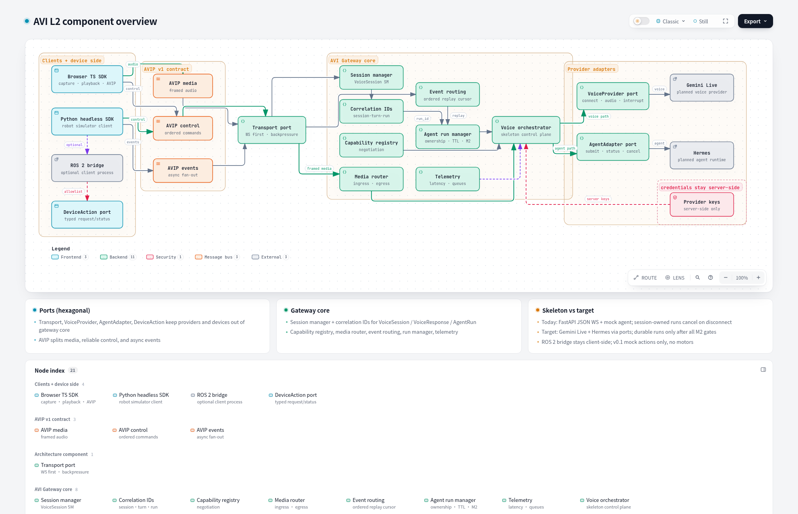

# Agent Voice Interface (AVI)

[](LICENSE)
[](https://github.com/nomi-bot/agent-voice-interface/commits/main)
[](https://github.com/nomi-bot/agent-voice-interface/graphs/commit-activity)

Give every AI agent and robot a natural voice.

AVI is an open-source, plug-and-play voice interaction layer, independent of
agent runtimes and model vendors. It is not an agent framework.

## What runs today

The Python 3.12+ loopback gateway serves browser and headless clients on
`/ws/avip`. It supports 16 kHz PCM, a mock audio mirror, and optional Gemini
Live audio. The browser can flush local playback, interrupt an active response
when negotiated, and reconnect with a fresh voice session. The headless
simulator exercises the same media route. An optional client-side ROS 2 bridge
exercises a synthetic sensor and an in-memory action.

An opt-in single-owner launcher connects AVIP to a dedicated Hermes Run API,
persists authorized tasks in SQLite and supports finding recent runs, replaying
updates and retrieving results after disconnect or restart. Uncertain provider
outcomes remain available for reconciliation. The plain Uvicorn entry point
keeps durable controls disabled. Legacy `/ws` offers a session-owned mock agent.

The [milestone gates](docs/roadmap/milestones.md) track system acceptance.
Reproduce the [headless scenarios](clients/robot/README.md),
[browser fault checks](docs/roadmap/delivery/evidence/browser-duplex.md) and
[release qualification](docs/roadmap/delivery/release.md).

## Local development (macOS / Mac Mini)

From a checkout of this revision, install Python 3.12 or newer (for example, Homebrew: `brew install python@3.12`).

```sh
python3.12 -m venv .venv
source .venv/bin/activate
python -m pip install -e '.[dev,gemini-live]'
python -m uvicorn avi.main:app --host 127.0.0.1 --port 8000 --ws-max-size 16384 --ws-max-queue 16
```

Check `http://127.0.0.1:8000/health` or `/docs`. No credentials are needed for
the mock. `.env.example` names the server-side key and the Live model variable.
Set these variables in the server environment. Never commit a populated `.env`.

```sh
python -m unittest discover -s tests -v
```

## Run the local Hermes gateway

Use a dedicated Hermes API server at a numeric loopback origin. The example
assumes port 8642, a configured model, `platform_toolsets.api_server: []`, and
a dedicated API bearer. Set `HERMES_API_KEY` to the same value as Hermes'
`API_SERVER_KEY` in the AVI server environment. The [Hermes integration
record](docs/providers/hermes.md) identifies the pinned upstream revision and
tested profile. Stop the plain gateway before starting this launcher.

```sh
python -m pip install -e '.[hermes]'
python -m avi.local_gateway --state-dir ~/.avi-local --owner demo \
  --hermes-origin http://127.0.0.1:8642 --backend-scope local-demo-v1 \
  --allow-query 'Summarize the greeting.'
```

The launcher binds port 8000 and creates a private state directory. On
`http://127.0.0.1:8000/voice`, expand **Local agent tasks**. Paste the value
from `~/.avi-local/client.grant` into **Local grant**. **Find my runs** lists
up to 16 recent IDs. Choose one, paste the grant again and use **Read result**
or **Replay updates**. These operations work without a microphone or Gemini.
An empty list is expected before the first task.

For voice delegation, install the `gemini-live` extra and configure
`GEMINI_API_KEY` and `GEMINI_LIVE_MODEL` before starting the launcher. Paste
the grant, select **Enable agent tasks on my next voice session**, then start
the microphone. The example authorizes exactly `Summarize the greeting.`
including capitalization and punctuation. The tool argument must match that
string. Each additional approved query requires its own `--allow-query`.

The grant expires after 900 seconds by default. Set `--grant-seconds` to a
positive lifetime at startup. To rotate, stop the launcher and restart with
the same state directory, owner and backend scope. Paste the newly issued
grant for subsequent connections. To suspend submissions and user-requested
cancellation, restart with the same settings and replace `--allow-query …`
with `--read-only`. Authorized recovery and reads continue. Change the
nonsecret backend scope when the Hermes origin, profile or credential epoch
changes so existing handles stay associated with their original backend.

## Gemini Live provider

`GeminiLiveProvider` speaks the existing port: 16 kHz uplink, 24 kHz downlink
resampled to 16 kHz with a streaming converter, bounded queues, and
`close` on connect failure, `GoAway`, and cancel. Its default tool is
`avi_ack`. Durable voice sessions can also expose `avi_delegate_read_only` and
`avi_read_run_result`. `/ws/avip`
opens that session when `GEMINI_API_KEY` and `GEMINI_LIVE_MODEL` are both set.
`GET /health` reports `voice` as `live`, `mock`, or `not_configured`.
Details, the microphone soak, and the deferred list are in
[the provider record](docs/providers/gemini-live.md).

The compatibility smoke is unchanged. It opens one short Live session only when
`GEMINI_API_KEY` and `GEMINI_LIVE_MODEL` are both set.

```sh
python -m pip install -e '.[dev,gemini-live]'
python -m unittest discover -s tests -v
python -m avi.providers.gemini_live_spike
```

Without `GEMINI_API_KEY`, discovery skips the network cases and the smoke
module exits 2. With a key and no `GEMINI_LIVE_MODEL`, both fail instead of
choosing a model. Exit 0 from the smoke module means a live turn completed.
The adapter's duplex and tool-handshake tests run in that same discovery and
skip for the same reason. Model codes and the async-tool limits are in
[ADR-011](docs/adr/011-gemini-live-compatibility.md).

## WebSocket smoke test

Open `http://127.0.0.1:8000/docs` in a browser, then use its developer console:

```js
const ws = new WebSocket("ws://127.0.0.1:8000/ws");
ws.onmessage = e => console.log(JSON.parse(e.data));
ws.onopen = () => ws.send(JSON.stringify({type: "submit", request: "demo"}));
// Copy the id from the run response:
ws.send(JSON.stringify({type: "status", run_id: "<returned id>"}));
ws.send(JSON.stringify({type: "cancel_task", run_id: "<returned id>"}));
```

The mock completes after one second. Status is retrieved explicitly; no progress
push channel is implemented. `ping` returns `pong`; `stop_playback` returns a
client instruction without cancelling a task. `cancel_response` is explicitly
unsupported until a provider implements it. Runs belong to one session and are
cancelled on disconnect. Each session retains at most 32 runs and expires after
300 seconds without a message.

Agent operations execute sequentially with a 30-second deadline. Receiving stays
active during those operations, so `ping`, `stop_playback` and disconnects do not
wait for an agent response. Control replies can overtake agent replies.
There are at most 16 queued operations and 16 queued replies. Excess operations
return an error; a full reply queue or a send stalled for 5 seconds closes the
session with code 1013. Initial `ready` sends and close frames also have a
5-second deadline. Adapter cleanup has a 5-second deadline. These are control-plane
safeguards, not measured realtime audio guarantees. Adapters must cooperate with
asyncio cancellation and must not run blocking work on the event loop.

## AVIP handshake

`/ws/avip` is a separate socket from the legacy control protocol. With the server
running as above, a browser on `http://127.0.0.1:8000` can open it from the
developer console:

```js
const avip = new WebSocket("ws://127.0.0.1:8000/ws/avip");
avip.onmessage = e => console.log(JSON.parse(e.data));
avip.onopen = () => avip.send(JSON.stringify({
  protocol: "avip/1",
  type: "session.start",
  request_id: "req-001",
  session_id: null,
  device_id: "browser-demo-001",
  capabilities: {audio_input: true, audio_output: true}
}));
```

By default, the `session.ready` reply carries a gateway-assigned
`session_id` and all five capabilities set to false. Requesting audio does not
enable a media path, and a binary frame closes the socket. Closing the socket
discards that id. A second `session.start` on the same socket returns
`session_already_started` and the server closes the connection. Error envelopes
contain only `protocol`, `type`, `code` and `field`. The rules and close codes
are in the [AVIP draft](docs/protocols/avip-v1.md).

## AVIP conformance

Browser-shaped and headless Python clients use the same `/ws/avip` route.
There is no second gateway and no device-specific branch. From the project
environment, with `AVIP_MOCK_MEDIA` unset:

```sh
python3.12 -m unittest discover -s tests -v
python3.12 -m unittest discover -s tests -p 'test_avip*.py' -v
```

The second command includes the SDK byte comparison. That comparison runs the
browser adapter under Node. Node 22 is enough, and the suite does not install
a JavaScript package.

The conformance tests turn on the shared fixture's audio availability, drive
both clients through handshake and a PCM round-trip, and check `queue_full` and
other media errors. The headless client is the `avip_client` package. It packs
frames itself and can open `ws://127.0.0.1:8000/ws/avip`. The browser adapter is
[`clients/browser/avip-client.js`](clients/browser/avip-client.js). It packs
frames with `DataView` and does not import `avip_client`. A Node run of that
file checks that the two encoders emit the same `session.start` text and the
same binary frames. There is no intentional difference on the wire. The
in-process browser double in `tests/avip_clients.py` is only a test helper.

`avip_client` is the headless SDK. This speaks the same gateway without going
through the test helper:

```python
import asyncio
from avip_client import AvipClient

async def main():
    async with AvipClient(
        "ws://127.0.0.1:8000/ws/avip",
        request_id="req-python-001",
        device_id="headless-sim-001",
        capabilities={"audio_input": True, "audio_output": True},
    ) as client:
        ready = await client.start()
        await client.send_uplink(bytes(640))
        print(ready["session_id"], await client.recv())

asyncio.run(main())
```

Leave `AVIP_MOCK_MEDIA` and the Live variables unset for the unit suite. Set
`AVIP_MOCK_MEDIA=1` before this snippet when Live is not configured, or
`session.ready` reports every capability false and the binary frame closes
the socket. With both Live variables set, the same snippet talks to Gemini
instead of echoing.

To hear the microphone come back through the speakers, start the gateway with
the mock mirror enabled and open the voice page on that same origin. Use
headphones. The page asks for microphone permission, sends 20 ms PCM uplink
frames, and plays 16 kHz downlink. On the mock path those bytes are the
microphone again. On the Live path they are the provider after 24 kHz to
16 kHz resampling in the gateway. **Stop playback** flushes only the
local speaker. It does not send a control message and it does not close the
session. If the WebSocket send queue reaches 8 unsent nominal frames, later
microphone frames are dropped and counted. A dropped frame does not advance
the uplink sequence. It does advance the sender media clock, so the next sent
frame's timestamp shows the gap. A queue with no byte budget closes
the socket and releases the microphone. The page adopts the socket before the
handshake, so a failed handshake closes it too.

```sh
AVIP_MOCK_MEDIA=1 python3.12 -m uvicorn avi.main:app --host 127.0.0.1 --port 8000 --ws-max-size 16384 --ws-max-queue 16
```

Open `http://127.0.0.1:8000/voice` (or `http://localhost:8000/voice` if that is
the host you bound). `file://` and any other origin cannot use this page: the
microphone needs a secure context, and the gateway only accepts those two
origins. Leave Live unconfigured and `AVIP_MOCK_MEDIA` unset and the page
reports that audio was not negotiated.

The one-frame console paste is still
[tests/fixtures/browser-avip-client.js](tests/fixtures/browser-avip-client.js).
It does not open the microphone. The serializer the conformance test executes
is [clients/browser/avip-client.js](clients/browser/avip-client.js). Capture and
playback are [clients/browser/voice.js](clients/browser/voice.js).

Browser checks that do not need a microphone:

```sh
node clients/browser/voice-check.mjs
node clients/browser/voice-soak.mjs --seconds 2
python -m avi.telemetry --seconds 2
```

The soak writes one JSON report and does not open a microphone or a voice
provider. It is not part of the unit suite. Clocks, the live mock-mirror
probe, and the credential rule are in
[voice telemetry](docs/voice-telemetry.md).

`python3.12 -m unittest discover -s tests -v` runs `voice-check.mjs`. The manual
negative paths (permission denied, unplug, gateway stop) are listed on the
voice page.

That variable is exact: only `1` enables the mirror, and only when Live is
not configured. It does not enable robot actions. The mirror copies PCM into a
downlink frame. A mock sink on the same session takes accepted uplink frames
and discards them, so a continuous sender is not stuck after eight frames.
Live, when configured, forwards those frames to the provider instead of
mirroring them. The provider drops its own overflow; the socket does not
turn that into `queue_full`.
`queue_full` still means the bounded queue rejected the newest frame. That
happens when the sink is not taking frames as fast as they arrive. The socket
stays open, and the refused frame keeps its sequence.

## Security and integration boundaries

Bind to loopback only. Both `/ws` and `/ws/avip` check exact localhost origins on
port 8000; this is defense in depth, **not authentication**. `GET /voice` is the
local microphone demo on that same origin. It requests microphone permission in
the browser and sends PCM only to that gateway. Stopping playback does not send
a cancel. Do not expose the
development service through a proxy or bind it remotely. Mock requests execute no tools.
Future agent integrations must retain their own authorisation and approval
controls. Treat voice transcripts and tool arguments as untrusted input.

## System architecture



Level-2 component overview from accepted ADRs (clients → AVIP media/control/events → Transport → Gateway core → VoiceProvider/AgentAdapter → Gemini Live / Hermes). ROS 2 bridge is client-side; v0.1 mock actions only.

The Live voice mount and durable Hermes runtime use separate configuration. Enabling either keeps the same AVIP endpoint for both clients. The same map is in the [interactive overview](docs/architecture/avi-l2-architecture.html); [avi-l2-candidate.json](docs/architecture/avi-l2-candidate.json) is the source used to generate it.

## Documentation map

- [Current architecture](docs/architecture.md): gateway behavior and limitations.
- [Target architecture](docs/architecture/overview.md): device-neutral ports and integration boundaries.
- [Canonical roadmap](docs/roadmap/milestones.md): M0–M4 scope and required exit gates,
  including the complete M2 ownership, authorization, persistence and migration gates.
- [AVIP draft](docs/protocols/avip-v1.md): `/ws/avip` handshake, binary media
  frames, error envelopes, and the decisions still open. Legacy `/ws` is a separate socket.
- [ADR index and policy](docs/adr/README.md): design decisions and their implementation context.

The [legacy roadmap](docs/roadmap.md) redirects to the canonical plan and maps its
original milestones. v0.1 robotics scope is a simulator and optional ROS 2 bridge
with mock actions only; no physical actuation.

## License

Apache-2.0; see [LICENSE](LICENSE).
