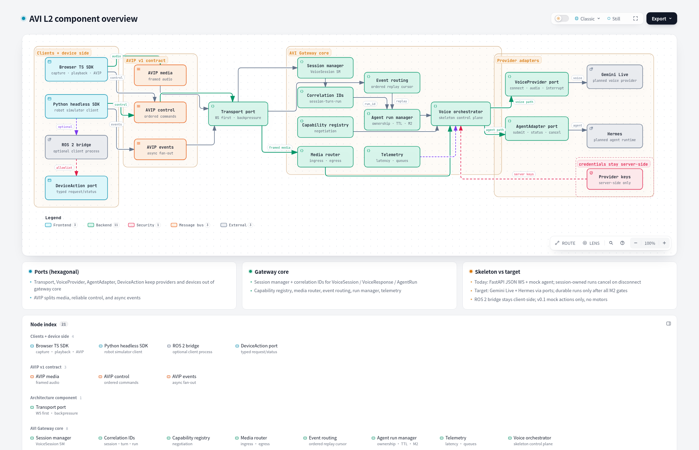

# Agent Voice Interface (AVI)

[](LICENSE)
[](https://github.com/nomi-bot/agent-voice-interface/commits/main)
[](https://github.com/nomi-bot/agent-voice-interface/graphs/commit-activity)


Give every AI agent and robot a natural voice.

AVI is an open-source, plug-and-play voice interaction layer, independent of
agent runtimes and model vendors. It is not an agent framework.

## Current status: initialization skeleton

The current implementation supplies a Python 3.12+ FastAPI gateway, four adapter contracts,
an asynchronous mock agent, a JSON WebSocket control protocol, tests and CI.
The original Apache-2.0 LICENSE is preserved.

**There is no Gemini connection or working Hermes integration yet.** A browser
page can capture a microphone and play the mock PCM mirror; that is not a voice
provider. No full-duplex, latency or macOS runtime performance claim
has been validated. Provider placeholders fail explicitly rather than simulating
a successful integration. No Google SDK dependency or unverified model ID is
introduced.

M0 is in progress. The gateway validates the AVIP v1 session handshake and serves
it on `/ws/avip`, together with binary media frames once audio input is
negotiated. A ready session lasts only as long as that socket; when the socket
closes, the session id and its media queue are gone. The development gateway
advertises no audio, camera, display, or robot capability unless
`AVIP_MOCK_MEDIA=1`, which enables the same PCM mirror for every client. `/ws`
still uses the legacy control protocol below. The headless SDK (`avip_client`)
and the browser adapter (`clients/browser/avip-client.js`) both speak `/ws/avip`.
`clients/browser/voice.js` captures microphone audio into that same uplink frame
and plays downlink PCM. A mock sink drains
accepted uplink frames on that socket. It is not a voice provider.
VoiceSession, VoiceResponse and AgentRun transitions are implemented in core.
`/ws/avip` records connecting, active and closed for that socket and still
does not drive reconnect, voice responses or agent runs. The remaining control
messages are still ahead, so M0 is not complete.

## Local development (macOS / Mac Mini)

Install Python 3.12 or newer (for example, Homebrew: `brew install python@3.12`).

```sh
git clone https://github.com/nomi-bot/agent-voice-interface.git
cd agent-voice-interface
python3.12 -m venv .venv
source .venv/bin/activate
python -m pip install -e '.[dev]'
python -m uvicorn avi.main:app --host 127.0.0.1 --port 8000 --ws-max-size 16384 --ws-max-queue 16
```

Check `http://127.0.0.1:8000/health` or `/docs`. No credentials are needed for
the mock. `.env.example` reserves a future server-side key; this skeleton does
not load environment files. Never commit a populated `.env`.

```sh
python -m unittest discover -s tests -v
```

## WebSocket smoke test

Open `http://127.0.0.1:8000/docs` in a browser, then use its developer console:

```js
const ws = new WebSocket("ws://127.0.0.1:8000/ws");
ws.onmessage = e => console.log(JSON.parse(e.data));
ws.onopen = () => ws.send(JSON.stringify({type: "submit", request: "demo"}));
// Copy the id from the run response:
ws.send(JSON.stringify({type: "status", run_id: "<returned id>"}));
ws.send(JSON.stringify({type: "cancel_task", run_id: "<returned id>"}));
```

The mock completes after one second. Status is retrieved explicitly; no progress
push channel is implemented. `ping` returns `pong`; `stop_playback` returns a
client instruction without cancelling a task. `cancel_response` is explicitly
unsupported until a provider implements it. Runs belong to one session and are
cancelled on disconnect. Each session retains at most 32 runs and expires after
300 seconds without a message.

Agent operations execute sequentially with a 30-second deadline. Receiving stays
active during those operations, so `ping`, `stop_playback` and disconnects do not
wait for an agent response. Control replies can overtake agent replies.
There are at most 16 queued operations and 16 queued replies. Excess operations
return an error; a full reply queue or a send stalled for 5 seconds closes the
session with code 1013. Initial `ready` sends and close frames also have a
5-second deadline. Adapter cleanup has a 5-second deadline. These are control-plane
safeguards, not measured realtime audio guarantees. Adapters must cooperate with
asyncio cancellation and must not run blocking work on the event loop.

## AVIP handshake

`/ws/avip` is a separate socket from the legacy control protocol. With the server
running as above, a browser on `http://127.0.0.1:8000` can open it from the
developer console:

```js
const avip = new WebSocket("ws://127.0.0.1:8000/ws/avip");
avip.onmessage = e => console.log(JSON.parse(e.data));
avip.onopen = () => avip.send(JSON.stringify({
  protocol: "avip/1",
  type: "session.start",
  request_id: "req-001",
  session_id: null,
  device_id: "browser-demo-001",
  capabilities: {audio_input: true, audio_output: true}
}));
```

By default, the `session.ready` reply carries a gateway-assigned
`session_id` and all five capabilities set to false. Requesting audio does not
enable a media path, and a binary frame closes the socket. Closing the socket
discards that id. A second `session.start` on the same socket returns
`session_already_started` and the server closes the connection. Error envelopes
contain only `protocol`, `type`, `code` and `field`. The rules and close codes
are in the [AVIP draft](docs/protocols/avip-v1.md).

## AVIP conformance

Browser-shaped and headless Python clients use the same `/ws/avip` route.
There is no second gateway and no device-specific branch. From the project
environment, with `AVIP_MOCK_MEDIA` unset:

```sh
python3.12 -m unittest discover -s tests -v
python3.12 -m unittest discover -s tests -p 'test_avip*.py' -v
```

The second command includes the SDK byte comparison. That comparison runs the
browser adapter under Node. Node 22 is enough, and the suite does not install
a JavaScript package.

The conformance tests turn on the shared fixture's audio availability, drive
both clients through handshake and a PCM round-trip, and check `queue_full` and
other media errors. The headless client is the `avip_client` package. It packs
frames itself and can open `ws://127.0.0.1:8000/ws/avip`. The browser adapter is
[`clients/browser/avip-client.js`](clients/browser/avip-client.js). It packs
frames with `DataView` and does not import `avip_client`. A Node run of that
file checks that the two encoders emit the same `session.start` text and the
same binary frames. There is no intentional difference on the wire. The
in-process browser double in `tests/avip_clients.py` is only a test helper.

`avip_client` is the headless SDK. This speaks the same gateway without going
through the test helper:

```python
import asyncio
from avip_client import AvipClient

async def main():
    async with AvipClient(
        "ws://127.0.0.1:8000/ws/avip",
        request_id="req-python-001",
        device_id="headless-sim-001",
        capabilities={"audio_input": True, "audio_output": True},
    ) as client:
        ready = await client.start()
        await client.send_uplink(bytes(640))
        print(ready["session_id"], await client.recv())

asyncio.run(main())
```

Leave `AVIP_MOCK_MEDIA` unset for the unit suite. Set it to `1` before this
snippet, or `session.ready` reports every capability false and the binary frame
closes the socket.

To hear the microphone come back through the speakers, start the gateway with
the mock mirror enabled and open the voice page on that same origin. Use
headphones. The page asks for microphone permission, sends 20 ms PCM uplink
frames, and plays the mirrored downlink. **Stop playback** flushes only the
local speaker. It does not send a control message and it does not close the
session.

```sh
AVIP_MOCK_MEDIA=1 python3.12 -m uvicorn avi.main:app --host 127.0.0.1 --port 8000 --ws-max-size 16384 --ws-max-queue 16
```

Open `http://127.0.0.1:8000/voice` (or `http://localhost:8000/voice` if that is
the host you bound). `file://` and any other origin cannot use this page: the
microphone needs a secure context, and the gateway only accepts those two
origins. Leave `AVIP_MOCK_MEDIA` unset and the page reports that audio was not
negotiated.

The one-frame console paste is still
[tests/fixtures/browser-avip-client.js](tests/fixtures/browser-avip-client.js).
It does not open the microphone. The serializer the conformance test executes
is [clients/browser/avip-client.js](clients/browser/avip-client.js). Capture and
playback are [clients/browser/voice.js](clients/browser/voice.js).

Browser checks that do not need a microphone:

```sh
node clients/browser/voice-check.mjs
```

`python3.12 -m unittest discover -s tests -v` runs that file. The manual
negative paths (permission denied, unplug, gateway stop) are listed on the
voice page.

That variable is exact: only `1` enables audio input and audio output. It does
not enable a voice provider or robot actions. The mirror copies PCM into a
downlink frame. A mock sink on the same session takes accepted uplink frames
and discards them, so a continuous sender is not stuck after eight frames.
`queue_full` still means the bounded queue rejected the newest frame. That
happens when the sink is not taking frames as fast as they arrive. The socket
stays open, and the refused frame keeps its sequence.

## Security and integration boundaries

Bind to loopback only. Both `/ws` and `/ws/avip` check exact localhost origins on
port 8000; this is defense in depth, **not authentication**. `GET /voice` is the
local microphone demo on that same origin. It requests microphone permission in
the browser and sends PCM only to that gateway. Stopping playback does not send
a cancel. Do not expose the
development service through a proxy or bind it remotely. Mock requests execute no tools.
Future agent integrations must retain their own authorisation and approval
controls. Treat voice transcripts and tool arguments as untrusted input.

## System architecture



Level-2 component overview from accepted ADRs (clients → AVIP media/control/events → Transport → Gateway core → VoiceProvider/AgentAdapter → Gemini Live / Hermes). ROS 2 bridge is client-side; v0.1 mock actions only.

The drawing is the accepted direction beside the initialization skeleton. It does not mean Gemini Live, Hermes, or durable runs are implemented. `/ws/avip` serves the handshake and the M0 PCM mirror; it does not speak to a voice provider. The same map is in the [interactive overview](docs/architecture/avi-l2-architecture.html); [avi-l2-candidate.json](docs/architecture/avi-l2-candidate.json) is the source used to generate it.

## Documentation map

- [Current architecture](docs/architecture.md): executable skeleton behavior and limitations.
- [Target architecture](docs/architecture/overview.md): accepted device-neutral direction;
  provider integration, AVIP and durable runs are planned capabilities.
- [Canonical roadmap](docs/roadmap/milestones.md): M0–M4 scope and required exit gates,
  including the complete M2 ownership, authorization, persistence and migration gates.
- [AVIP draft](docs/protocols/avip-v1.md): `/ws/avip` handshake, binary media
  frames, error envelopes, and the decisions still open. Legacy `/ws` is a separate socket.
- [ADR index and policy](docs/adr/README.md): one three-digit sequence, 001–010.
  ADRs 001–005 remain accepted; 006–010 extend them with explicit lineage.

The [legacy roadmap](docs/roadmap.md) redirects to the canonical plan and maps its
original milestones. v0.1 robotics scope is a simulator and optional ROS 2 bridge
with mock actions only; no physical actuation.

## License

Apache-2.0; see [LICENSE](LICENSE).
